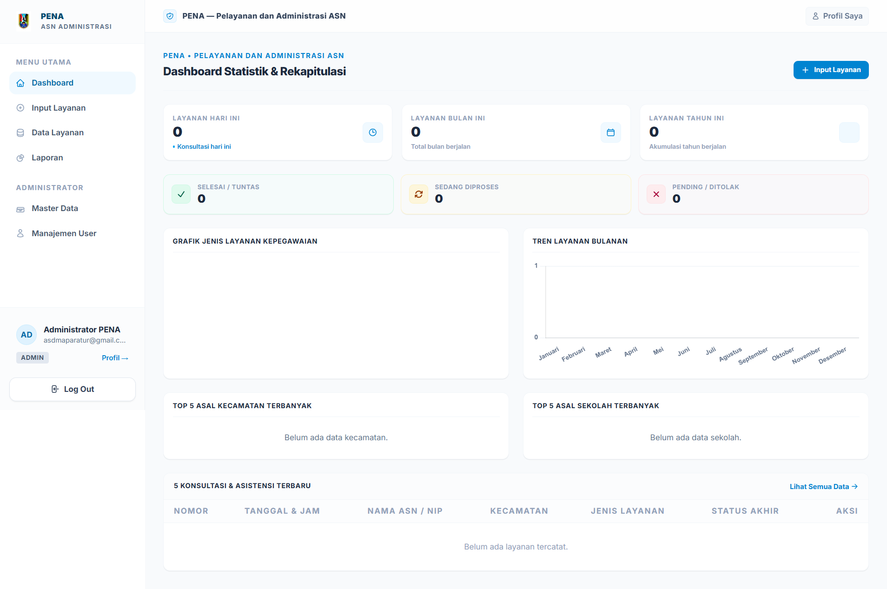
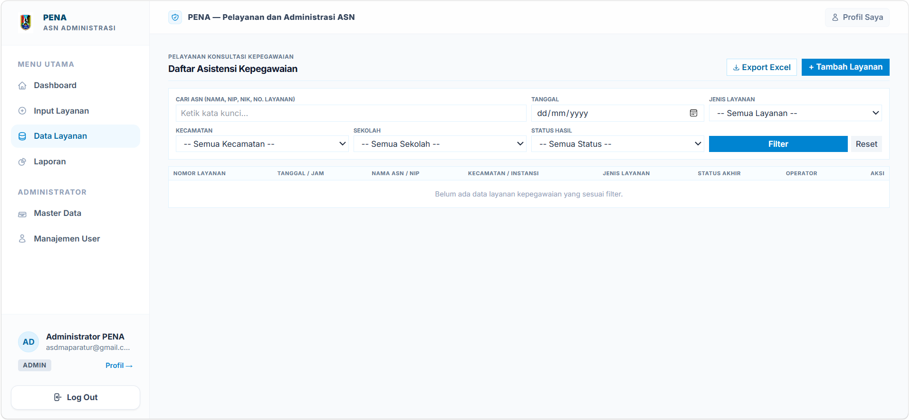
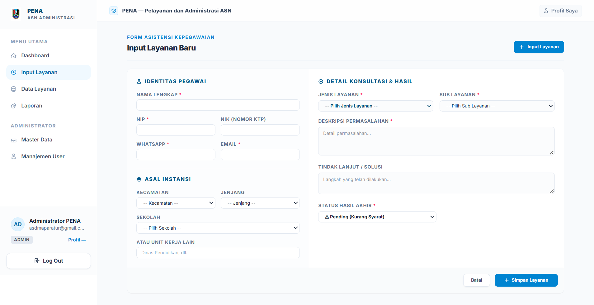
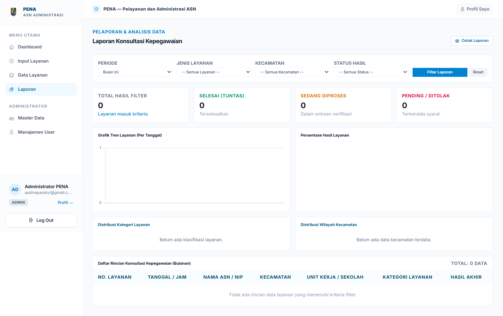
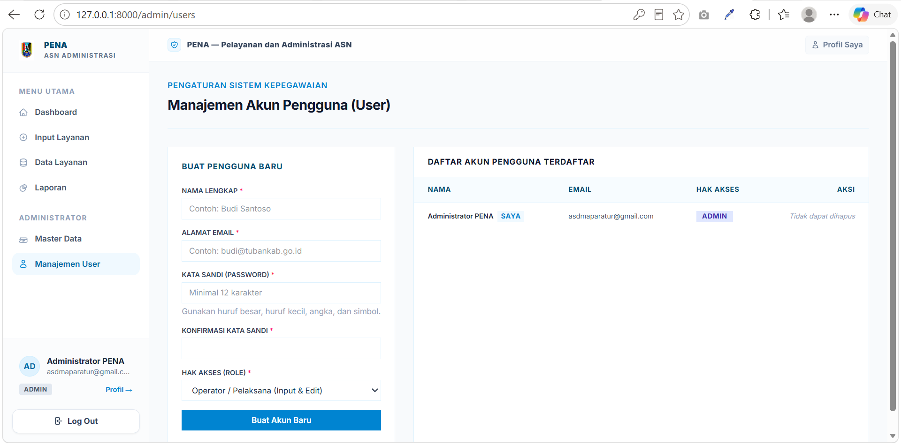
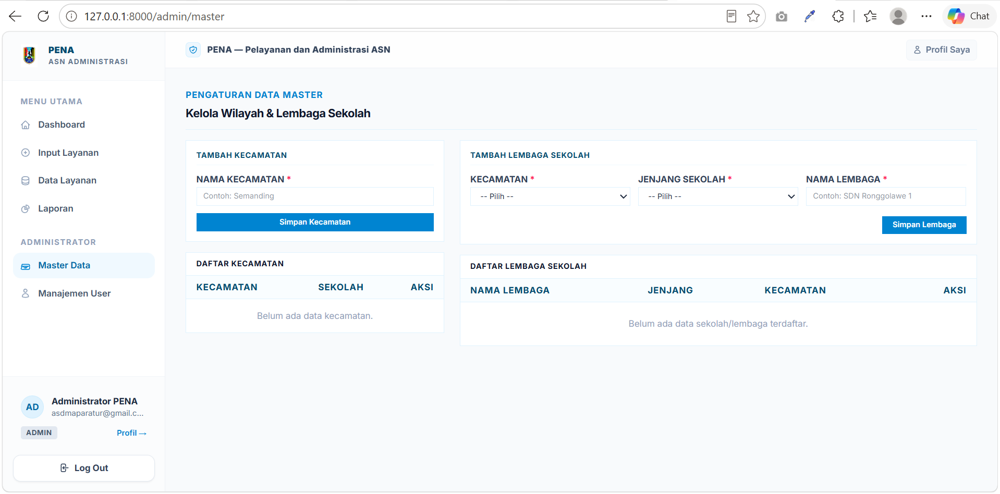

# PENA – Pelayanan dan Administrasi ASN

Aplikasi web administrasi layanan kepegawaian berbasis **PHP 8.3**, **Laravel 13**, Blade, Tailwind CSS 4, Vite, dan MySQL. Ini project PHP/Laravel penuh, bukan HTML statis. Node.js hanya dipakai untuk membangun aset frontend.

## Kebutuhan

- PHP 8.3+ beserta ekstensi PDO MySQL, OpenSSL, Mbstring, Fileinfo, Tokenizer, XML
- Composer 2
- Node.js + npm
- MySQL 8 atau MariaDB 10.6+
- Laragon direkomendasikan pada Windows karena menyediakan PHP, web server, dan MySQL

**phpMyAdmin bukan server aplikasi atau database.** phpMyAdmin hanya antarmuka untuk mengelola MySQL. MySQL Laragon harus aktif. Website dapat dilayani Apache/Nginx Laragon atau `php artisan serve`.

## Preview


## Fitur
<!--  -->









- Multi-role: Admin, Operator, Viewer read-only
- Dashboard dan laporan statistik portable untuk MySQL/SQLite
- Nomor layanan atomik: `PENA-YYYYMMDD-00001`
- Relasi FK Kecamatan, Sekolah, Layanan, User; snapshot nama tetap tersimpan untuk histori
- Input, edit, hapus, filter, cetak, ekspor Excel streamed
- Ubah password dari Profil; sesi lain otomatis dikeluarkan
- Lupa/reset password melalui email; token berlaku 60 menit
- Reset password user oleh Admin dengan verifikasi password Admin
- Email notifikasi akun dibuat dan password berubah
- Password sementara wajib diganti sebelum mengakses fitur lain
- Proteksi administrator terakhir, role authorization, input validation, rate limiting

## Instalasi dengan Laragon + Migration

1. Start **Apache/Nginx** dan **MySQL** di Laragon.
2. Buka phpMyAdmin: `http://localhost/phpmyadmin`.
3. Buat database kosong bernama `pena_kepegawaian`, collation `utf8mb4_unicode_ci`.
4. Jalankan:

```bash
composer install
npm install
copy .env.mysql.example .env
php artisan key:generate
php artisan migrate --seed
npm run build
php artisan optimize:clear
```

Sesuaikan kredensial MySQL di `.env` jika user/password Laragon bukan `root` tanpa password.

## Alternatif: Import SQL lewat phpMyAdmin

1. Start MySQL Laragon.
2. Buka phpMyAdmin → tab **Import**.
3. Pilih `database/pena_kepegawaian.sql`.
4. Import. File ini membuat database, seluruh tabel, FK, index, migration history, dan akun Admin awal.
5. Jalankan `composer install`, `npm install`, `php artisan key:generate`, `npm run build`, lalu `php artisan optimize:clear`.

Peringatan: SQL tersebut menghapus tabel PENA bernama sama sebelum membuat ulang. Jangan impor ke database produksi yang sudah berisi data tanpa backup.

## Akun Administrator Awal

- Email: `asdmaparatur@gmail.com`
- Password sementara: `admin123`

Login pertama diarahkan ke Profil dan wajib mengganti password. Password baru minimal 12 karakter, berisi huruf besar, huruf kecil, angka, dan simbol.

## Gmail SMTP

Aktifkan verifikasi 2 langkah akun Gmail, lalu buat **App Password**. Jangan memakai password Gmail utama. Isi `.env`:

```env
MAIL_MAILER=smtp
MAIL_HOST=smtp.gmail.com
MAIL_PORT=587
MAIL_SCHEME=smtp
MAIL_USERNAME=asdmaparatur@gmail.com
MAIL_PASSWORD=app_password_16_karakter
MAIL_FROM_ADDRESS="asdmaparatur@gmail.com"
MAIL_FROM_NAME="${APP_NAME}"
```

Setelah mengubah `.env`:

```bash
php artisan optimize:clear
```

Jika `MAIL_PASSWORD` kosong, perubahan data tetap berhasil; aplikasi menampilkan warning bahwa email belum terkirim.

## Menjalankan Aplikasi

Via server bawaan Laravel:

```bash
php artisan serve
```

Buka `http://127.0.0.1:8000`. Alternatif: gunakan virtual host otomatis Laragon.

## Test dan Build

```bash
php artisan test
npm run build
```

Test memakai SQLite `:memory:` sehingga tidak mengubah database MySQL.

## Produksi

- Set `APP_ENV=production`, `APP_DEBUG=false`, dan `APP_URL` yang benar.
- Gunakan kredensial DB khusus, bukan root.
- Wajib HTTPS.
- Jalankan backup MySQL berkala.
- Jangan commit `.env` atau Gmail App Password.


